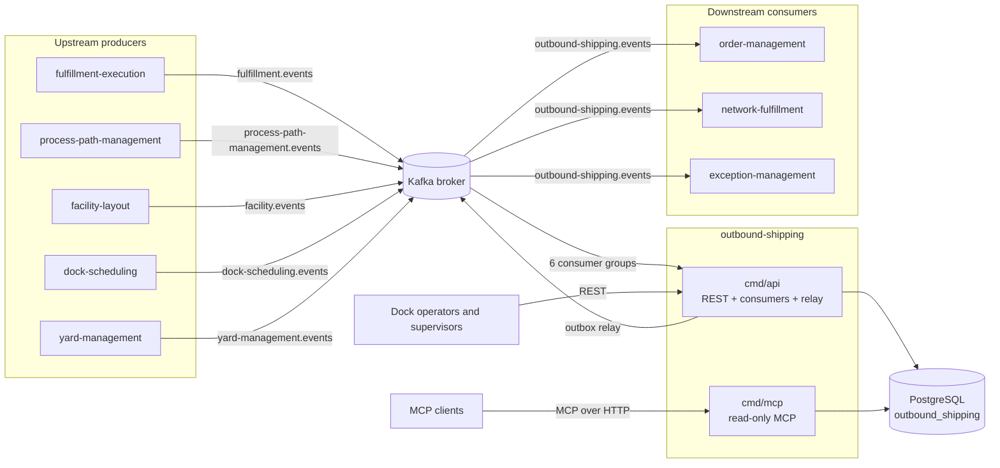

# Architecture

outbound-shipping is a Go service in hexagonal (ports and adapters) layout, checked by the fitness tests in `internal/architecture`. Two binaries are built from it. The relay of the transactional outbox and every Kafka consumer run **inside `cmd/api`**; there is no relay, projector or sweep binary.

Source: `cmd/api/wire.go`, `cmd/api/consumers.go`, `cmd/mcp/main.go`, `internal/architecture/architecture_test.go`, `Dockerfile`.

## Layout

```text
cmd/
  api/                   composition root: REST + 6 Kafka consumers + outbox relay
  mcp/                   composition root: read-only MCP server
internal/
  domain/                pure model, no I/O, no clock reads
    outboundload/        OutboundLoad aggregate (state machine, plan, close, confirm)
    shippingpackage/     ShippingPackage aggregate
    billoflading/        BillOfLading aggregate
    shared/              typed ids (SiteID, LoadID...), ShortShip
  application/
    usecases/            REST commands, consumer policies, queries; one unit of work each
    ports/               UnitOfWork, EventSink, Clock, LoadIDs, repositories, copies
    repository/          read-side types, filters, repository errors
    outbox/              the outbox Message and send-failure types
  adapters/
    inbound/http/        chi router, RFC 7807 problems, Idempotency-Key middleware, probes
    inbound/kafka/       CloudEvents consumers, retry, dead letters
    inbound/mcp/         MCP tools, resource, prompt
    kafka/cloudevents/   the one CloudEvents 1.0 builder and decoder
    outbound/postgres/   pgx repositories, unit of work, outbox repository, migrations runner
    outbound/events/     domain events to outbox messages (integration + analytics twin)
    outbound/outbox/     the relay loop
    outbound/kafka/      the relay's Kafka writer
    outbound/system/     clock and random ids
    outbound/memory/     in-memory doubles, TEST ONLY (cmd/ never imports them)
  architecture/          fitness tests
  testing/               pgtest, kafkatest (testcontainers helpers)
migrations/              embedded SQL (one migration pair)
apis/                    openapi.yaml, asyncapi.yaml
contracts/               pinned yard-management AsyncAPI
features/                godog scenarios and runner
```

Dependencies point inward: adapters depend on `application` and `domain`; `domain` imports nothing from the module. The MCP adapter may depend on the application layer only, and nothing may depend on it (`TestMCPAdapterDependencyRule`). Adapters never import each other: `cmd/` wires them.

Every use case runs in **one unit of work** (`ports.UnitOfWork`): aggregate writes, the outbox rows and, for a consumer, the inbox claim in `processed_events` commit or roll back together.

## Binaries

| Binary | Role | Port | Notes |
|---|---|---|---|
| `cmd/api` | REST API (13 routes, `/healthz`, `/readyz`), six Kafka consumers (fulfillment, dock, yard, cpt, layout, analytics), the outbox relay | `ADDR`, default `:8080` | Runs migrations at boot. No in-memory mode. `ENTRYPOINT ["./api"]` in the image. |
| `cmd/mcp` | Read-only MCP server over Streamable HTTP at `/` and `/mcp`, plus `GET /healthz` | `MCP_ADDR`, default `:8090` | Reads Postgres only; builds no event sink, no unit of work, no outbox repository, and never dials Kafka. Runs the same migrations at boot. Not exposed by the Dockerfile. |

No `cmd/a2a`: there is no A2A surface.

## Container diagram



Source: `cmd/api/wire.go` (`wire`, `startConsumers`, `startRelay`), `cmd/mcp/main.go` (`buildDeps`), `apis/asyncapi.yaml`.

The analytics topic `warehouse.outbound-shipping.analytics` is written by the same relay and read back by the `analytics` consumer of `cmd/api`; it is drawn as part of the `API` to Kafka loop and has no external consumer.

## Data stores

One PostgreSQL database (`DATABASE_URL`), shared by both binaries; migrations are embedded and applied at boot. There is no cache, no second database and no object store.

| Group | Tables | Written by |
|---|---|---|
| Aggregates | `outbound_loads`, `shipping_packages`, `bills_of_lading` | REST commands and consumer policies (optimistic lock on `version`) |
| Local copies of neighbours | `cpt_schedules`, `zones`, `locations`, `dock_appointments`, `door_work_completions` | the cpt, layout, dock and yard consumers |
| Reliability | `outbox_events` (transactional outbox), `processed_events` (inbox), `idempotency_keys` (REST `Idempotency-Key` answers) | use cases, the relay, the HTTP middleware |
| Read model | `load_board` (the LoadBoardView) | the analytics consumer (`ProjectBoard`) |

The full schema is on [Entity relationship](/docs/ddd/entity-relationship). The pool holds at most 10 connections with a 5 s statement timeout per connection.

## Message path

1. A command or consumer policy mutates an aggregate and the sink writes **two** outbox rows per event (integration topic and analytics topic) in the same transaction (`internal/adapters/outbound/events/sink.go`).
2. The relay claims unpublished rows `FOR UPDATE SKIP LOCKED`, writes them to Kafka with `RequireAll` acks and the aggregate id as key, and marks them published.
3. The own analytics consumer folds the analytics twin into `load_board`.

Every message is a CloudEvents 1.0 structured-mode event built and decoded only through `internal/adapters/kafka/cloudevents`.

## Shutdown order

On `SIGTERM`: readiness flips to not ready, the consumers stop, then the relay, each is awaited and closed, HTTP drains for up to 10 s, and finally the relay writer and the Postgres pool are closed. See the [runbook](/docs/operations/runbook).
